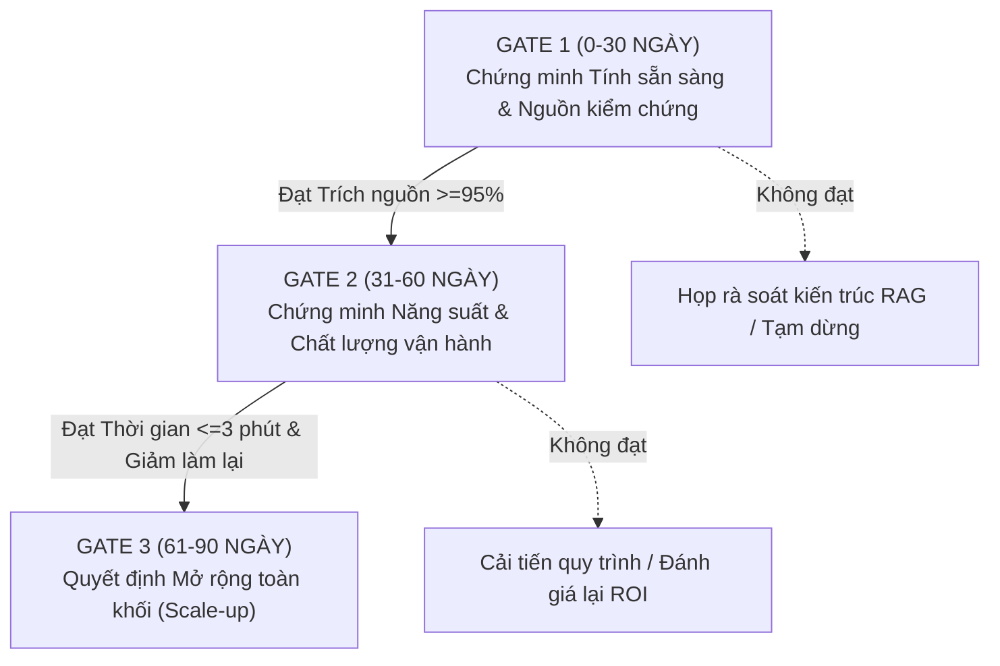

# MEMO QUYẾT ĐỊNH ÁP DỤNG AI (AI ADOPTION DECISION MEMO)

**Kính gửi:** Ban Điều Hành & Trưởng Khối Vận Hành  
**Đồng kính gửi:** Ban Công Nghệ & Quản Trị Rủi Ro  
**Dự án:** Trợ lý AI Tra cứu Quy trình & Chính sách Nội bộ (Internal Knowledge AI Assistant)  
**Nhóm thực hiện:** Promt Kiếm Tông (`Day26_Track01_Promt_Kiem_Tong`)  
**Thành viên dự án:**  
1. **Trần Đình Hinh** (`2A202602399`) - Trưởng nhóm / Phụ trách Chẩn đoán Gartner-Lite & Mollick  
2. **Hoàng Quốc Dũng** (`2A202602523`) - Phụ trách Quy trình TO-BE & Lộ trình 30-60-90  
3. **Đinh Xuân Quyền** (`2A202602358`) - Phụ trách ADKAR & Dashboard Hành Động  
**Ngày lập memo:** 14/10/2026 | **Phiên bản:** v2.0 (Sau phản biện chéo)  

---

### 1. Vấn đề và Nguyên nhân gốc

#### 1.1. Hiện trạng vấn đề
Sau 4 tuần triển khai cấp phát tài khoản (*Deployment*) cho 25 chuyên viên thuộc Phòng Vận hành & Hỗ trợ Khách hàng, hệ thống ghi nhận tỷ lệ ứng dụng thực tế (*Adoption*) chỉ đạt **18%**. Nhân viên có xu hướng bỏ rơi công cụ và quay lại quy trình truyền thống: tìm kiếm file Word/PDF thủ công trên các thư mục dùng chung hoặc trực tiếp hỏi đồng nghiệp thâm niên. Thời gian trung bình để xử lý 1 yêu cầu tra cứu chính sách phức tạp vẫn ở mức cao: **8.5 phút/lượt**, gây nghẽn tiến độ hỗ trợ khách hàng.

#### 1.2. Nguyên nhân gốc rễ (Root Cause)
Ban đầu, nhóm quản lý dự án cho rằng nhân viên "chưa quen dùng công nghệ" hoặc "thiếu kỹ năng đặt câu hỏi (prompt engineering)" và dự kiến mở thêm các lớp đào tạo. Tuy nhiên, qua quá trình điều tra thực tế, nguyên nhân gốc hoàn toàn không nằm ở kỹ năng, mà gồm 2 điểm cốt lõi:
1. **Thiếu Kiến trúc Tin cậy (Lack of Trust Architecture):** Hệ thống AI đưa ra các đoạn văn bản tổng hợp nhưng **hoàn toàn không có trích dẫn nguồn** (không có link văn bản, không có số điều khoản và không ghi rõ ngày ban hành).
2. **Quy trình chưa xác định ranh giới trách nhiệm & Cơ chế chuyển giao:** Quy chế vận hành chưa xác định ai là người chịu trách nhiệm khi AI trích xuất sai lệch; chưa có quy trình xử lý khi AI gặp câu hỏi mơ hồ hoặc tài liệu bị mâu thuẫn.

---

### 2. Framework đã dùng và Bằng chứng thực tế

Để đi đến kết luận trên một cách khoa học, nhóm Promt Kiếm Tông đã áp dụng kết hợp 3 framework chuẩn quốc tế:

#### 2.1. Phân tích Gartner-Lite (Đánh giá mức độ sẵn sàng tổ chức)
- **Direction (Hướng đi):** **ĐẠT**. Mục tiêu rõ ràng: rút ngắn thời gian xử lý nghiệp vụ, giảm tải cho nhân sự cấp cao.
- **Readiness (Mức sẵn sàng):** **THIẾU NGHIÊM TRỌNG**. Kho dữ liệu nội bộ bị phân mảnh, có nhiều văn bản đã hết hiệu lực nhưng vẫn nằm trong kho dữ liệu nạp vào AI. Chưa có vai trò **Data Owner** chịu trách nhiệm thẩm định và cập nhật văn bản định kỳ.
- **Absorption (Khả năng hấp thụ & duy trì):** **THIẾU**. Chưa có cơ chế tiếp nhận phản hồi lỗi từ người dùng cuối, chưa có kênh hỗ trợ kỹ thuật tại chỗ khi AI đưa câu trả lời sai.

#### 2.2. Phân tích Mollick Model (Phân chia công việc Người – AI)
- Đã phân lập rõ ràng 3 vùng công việc:
  - **Người giữ quyền (Human in Charge):** Chuyên viên vận hành là người duy nhất có quyền duyệt nội dung và chịu trách nhiệm pháp lý khi gửi thông tin cho khách hàng. AI tuyệt đối không tự động gửi email/chat trực tiếp tới khách hàng.
  - **AI hỗ trợ (AI Assist):** AI làm nhiệm vụ đọc lướt, trích xuất điều khoản và tóm tắt nội dung chính sách kèm trích dẫn văn bản gốc.
  - **AI tự động (Automated):** Tạm thời chưa áp dụng vùng này cho tới khi độ chính xác của mô hình đạt trên 99%.

#### 2.3. Phân tích ADKAR (Điểm nghẽn tâm lý hành vi)
- Nhân viên có nhận thức tốt (*Awareness*) và biết cách gõ câu hỏi (*Knowledge*). Tuy nhiên, điểm nghẽn chí mạng nằm ở **Desire (Mong muốn/Động lực áp dụng)**.
- Trong nghiệp vụ ngân hàng/vận hành, tư vấn sai chính sách dẫn tới phạt chế tài nặng nề. Do AI không hiện nguồn kiểm chứng, nhân viên sợ rủi ro nên từ chối sử dụng. Mở lớp đào tạo sẽ hoàn toàn vô ích nếu không giải quyết được vấn đề trích dẫn nguồn.

#### 2.4. Bằng chứng thực nghiệm
- **Log hệ thống:** Trong 450 phiên truy vấn tuần qua, 65% trường hợp nhân viên không bấm sao chép kết quả của AI mà tiếp tục mở đồng thời thư mục nội bộ để tự kiểm tra lại.
- **Phỏng vấn định tính:** 10/10 chuyên viên được hỏi đều trả lời: *"Chúng tôi sẵn sàng dùng AI nếu hệ thống chỉ rõ câu này trích từ Quyết định số mấy, Điều nào. Nếu không có nguồn, chúng tôi bắt buộc phải đọc lại văn bản gốc để tự bảo vệ mình."*
- **Tham chiếu quốc tế:** Bài học từ Morgan Stanley (2023) chứng minh rằng việc triển khai AI thành công cho hàng nghìn cố vấn tài chính phụ thuộc hoàn toàn vào cơ chế "Verifiable Citations" (Trích dẫn có thể kiểm chứng).

---

### 3. Ít nhất 02 thay đổi cụ thể sau phản biện chéo (từ Nhóm 05)

Sau phiên kiểm tra chéo ở Chặng 3 với Nhóm 05, nhóm Promt Kiếm Tông đã tiếp thu và thực hiện 2 thay đổi mang tính quyết định trong bản thiết kế v2:

| Hạng mục | Bản v1 (Trước phản biện) | Bản v2 (Sau phản biện chéo) | Rationale (Lý do thay đổi) |
| :--- | :--- | :--- | :--- |
| **Thay đổi 1: Hệ thống chỉ số đo lường** | Sử dụng chỉ số *"Số lượng prompt/câu hỏi gửi lên AI mỗi ngày"* (Tầng 1 - Activity Metric). | **Loại bỏ chỉ số prompt ảo.** Thay bằng: *"Tỷ lệ câu trả lời có trích dẫn văn bản và điều khoản chính xác ≥ 95%"* (Tầng 4 - Quality Metric) và *"Tỷ lệ tra cứu thành công không cần hỏi lại đồng nghiệp ≥ 80%"* (Tầng 2 - Behavior Metric). | Nhóm 05 chỉ ra rằng số lượng câu hỏi cao có thể do người dùng hỏi đi hỏi lại vì AI trả lời sai/không đúng ý. Đo lường trích nguồn và tỷ lệ không cần làm lại mới phản ánh đúng chất lượng và giá trị thực tế. |
| **Thay đổi 2: Cơ chế Governance & Kiến trúc tin cậy** | Chỉ nêu chung chung "cần cập nhật tài liệu thường xuyên" và chưa có quy trình khi AI không chắc chắn. | **Bổ sung vai trò Data Owner chính thức** phụ trách dán nhãn hiệu lực văn bản hàng tuần; thiết lập **Cơ chế Handoff tự động**: Khi độ tin cậy < 85%, AI tự động hiển thị cảnh báo và chuyển ticket về Chuyên viên chính kèm tóm tắt ngữ cảnh. | Khắc phục triệt để lỗ hổng về Governance của Gartner-Lite, tạo điểm tựa an toàn cho nhân viên giải tỏa điểm nghẽn Desire trong ADKAR. |

---

### 4. Quyết định cuối cùng

👉 **PHÁN QUYẾT: SỬA (PIVOT / FIX READINESS & GOVERNANCE TRƯỚC KHI ROLLOUT)**

- **Không chọn "TIẾP TỤC (Scale)":** Vì nếu vội vàng mở rộng cấp tài khoản cho 200 nhân viên toàn khối trong khi kho dữ liệu chưa có Data Owner và tính năng trích nguồn chưa bật, công ty sẽ lãng phí ngân sách license và tạo ra làn sóng bài xích công nghệ do thông tin sai lệch.
- **Không chọn "DỪNG (Kill)":** Vì bài toán tiết kiệm thời gian tra cứu từ 8.5 phút xuống 3.0 phút là hoàn toàn khả thi và có ROI vượt trội (tiết kiệm trên 120 giờ công/tháng cho chỉ riêng 25 nhân sự).
- **Lựa chọn "SỬA":** Giữ nguyên quy mô pilot 25 người trong 30 ngày tiếp theo để hoàn thiện tính năng trích dẫn nguồn, bổ nhiệm Data Owner làm sạch kho tài liệu và kiểm thử lại theo bộ chỉ số Dashboard v2.

---

### 5. Kế hoạch hành động 30–60–90 ngày & Phân công trách nhiệm (Owners)

#### 5.1. Gate 1: 0 – 30 ngày (Chứng minh Tính sẵn sàng & Nguồn trích dẫn)
- **Mục tiêu:** Xử lý triệt để nguyên nhân gốc về dữ liệu và độ tin cậy.
- **Hành động cụ thể:**
  1. *Kỹ thuật:* Bật tính năng trích dẫn nguồn (Citation) hiển thị kèm mỗi câu trả lời (Link văn bản, Điều, Khoản, Ngày cập nhật). *(Owner: AI Tech Lead - Hoàng Quốc Dũng)*.
  2. *Dữ liệu:* Ban hành danh mục 120 văn bản quy trình chuẩn hóa; phân công 01 chuyên viên làm Data Owner chịu trách nhiệm cập nhật văn bản mới vào thứ Sáu hàng tuần. *(Owner: Trưởng phòng Quy trình Vận hành)*.
  3. *Quy chế:* Ban hành hướng dẫn trách nhiệm kiểm chứng (Mollick TO-BE workflow) cho 25 nhân viên pilot. *(Owner: Trưởng phòng Vận hành - Trần Đình Hinh)*.
- **Điều kiện mở Gate 1:** Tỷ lệ câu trả lời có trích dẫn nguồn đạt ≥ 95% trên mẫu kiểm tra 100 câu hỏi.

#### 5.2. Gate 2: 31 – 60 ngày (Chứng minh Chất lượng & Năng suất)
- **Mục tiêu:** Đo lường sự thay đổi hành vi và năng suất làm việc của nhân viên.
- **Hành động cụ thể:**
  1. Theo dõi thời gian xử lý tra cứu ticket qua log hệ thống (kỳ vọng giảm từ 8.5 phút xuống ≤ 4.0 phút).
  2. Triển khai nút "Báo lỗi 1-Click" và cơ chế chuyển giao chuyên viên khi AI không chắc chắn. *(Owner: Đinh Xuân Quyền)*.
  3. QA audit ngẫu nhiên 10% các phiên tra cứu để đảm bảo không có câu trả lời sai lệch chính sách nghiêm trọng. *(Owner: Trưởng nhóm QA)*.
- **Điều kiện mở Gate 2:** Tỷ lệ tra cứu không cần hỏi lại đồng nghiệp đạt ≥ 80%; thời gian xử lý trung bình đạt ≤ 3.5 phút.

#### 5.3. Gate 3: 61 – 90 ngày (Quyết định Mở rộng toàn diện - Normalization)
- **Mục tiêu:** Hoàn thiện bài toán kinh tế (Business Case) và chuẩn bị nhân rộng.
- **Hành động cụ thể:**
  1. Tổng kết số giờ lao động tiết kiệm được (kỳ vọng ≥ 120 giờ/tháng cho nhóm pilot).
  2. Trình Ban Giám Đốc phê duyệt ngân sách mở rộng cấp tài khoản cho 200 nhân viên thuộc toàn bộ khối Vận hành và các chi nhánh.
  3. Chuyển giao quy chế vận hành cho Phòng Nhân sự & Đào tạo để đưa AI vào chương trình Onboarding nhân viên mới (Đạt trạng thái *Normalization*). *(Owner: Ban Điều Hành & Trưởng Khối Vận Hành)*.
- **Điều kiện mở Gate 3:** Tỷ lệ nhân viên tự nguyện sử dụng hàng tuần đạt ≥ 85%, tỷ lệ hài lòng nội bộ đạt ≥ 4.5/5.0.

---
*Memo được lập và chịu trách nhiệm bởi Nhóm Promt Kiếm Tông (Day26_Track01_Promt_Kiem_Tong).*
